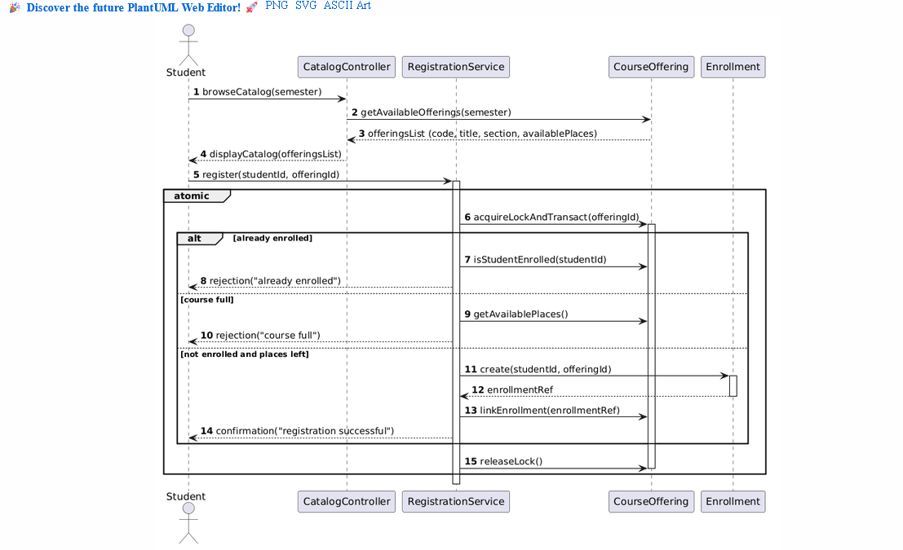
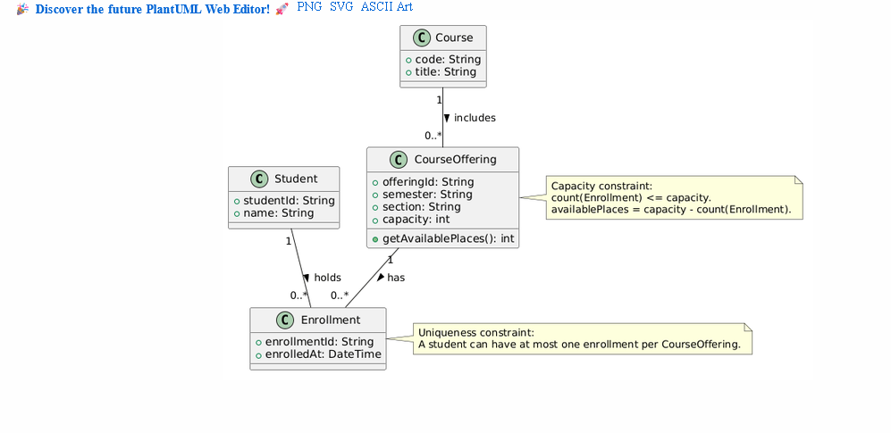
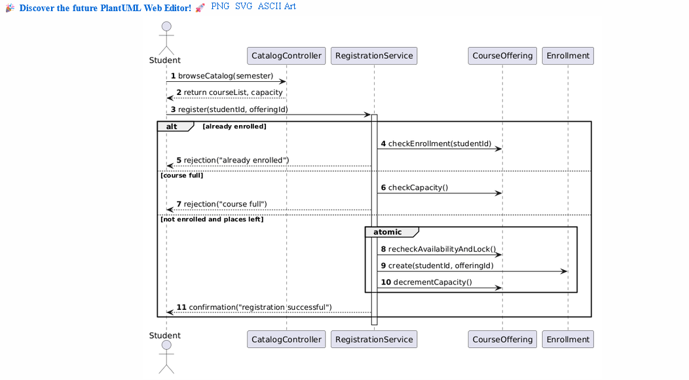
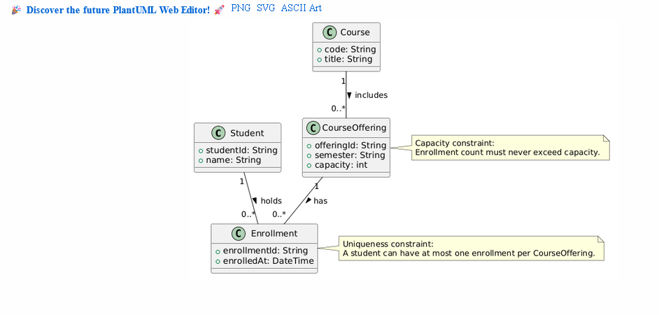

# SIS #02 — AI-Assisted UML Modeling: University Course Registration

<!--
  This is the only file you write your report in. README.md tells you what goes where.

  Rules the checker relies on:
  - Do not delete, rename or renumber the ## headings, the ### headings, or the **Label:** words.
  - Replace every "(write here)" and "(paste here)". None may be left when you submit.
  - Comments like this one are ignored by the checker and the word counter. Delete them or leave them.
-->

## 1. Scope and assumptions

<!-- Your FINAL scope statement and assumptions, after reviewing Prompt A's output. Say here
     what is out of scope (payments, prerequisites, timetable clashes, waiting lists,
     cancellation) — section 2 must not mention them. Section 10 keeps your first version. -->

**Scope:** (write here)

**Assumptions:**

1. (write here)
2. (write here)

## 2. User stories and acceptance criteria

<!-- Your APPROVED requirements: Prompt A's draft after your review. Keep the IDs, the three
     story headings and the bullet shape. Every criterion names the rule(s) it maps to,
     e.g. (R2, R4). Two criteria per story. Nothing out of scope.
     Format of a criterion, on one bullet:
     - **AC-03** (R2, R4): Given ..., When ..., Then ... -->

### US-01 — Browse offerings

**US-01: Catalog Browsing**
  As an authenticated student, I want to view the course catalog with real-time seat availability for a given semester, so that I can select an open course offering for registration.

- **AC-01** (Rule R1): Given an authenticated student viewing the electronic course catalog for a selected semester, When the student requests the course list, Then the system displays each course's code, title, offering section, and available places.
- **AC-02** (Rule R1): Given an authenticated student browsing the catalog, When a course offering has reached its maximum capacity, Then the system displays 0 available places for that offering without reserving seats or creating enrollments.

### US-02 — Register for an offering

**US-02: Successful Registration**
  As an authenticated student, I want to register for a course offering that has available capacity, so that I can secure my place in the course for the semester.

- **AC-03** (Rules R2, R4): Given an authenticated student who is not currently enrolled in the selected course offering, And the offering has at least 1 available place, When the student submits a registration request, Then the system rechecks availability, creates exactly one Enrollment record linking the student and the offering, updates available places, and returns a confirmation message.
- **AC-04** (Rules R2, R4): Given an offering with capacity 2 and 1 existing enrollment, When a second eligible student submits a registration request, Then total enrollment becomes 2, available capacity updates to 0, and a success confirmation is returned.

### US-03 — Receive a clear rejection

**US-03: Registration Rejection**
  As an authenticated student, I want to receive an explicit rejection reason when I attempt an invalid registration, so that I understand why my registration failed and my state remains unchanged.

- **AC-05** (Rules R2, R5): Given a student attempting to register for a course offering where current enrollment equals capacity (0 places available), When the registration request is processed, Then the system rejects the request, displays "course full", creates no Enrollment record, and leaves total enrollment unchanged.
- **AC-06** (Rules R3, R5): Given a student who already has an active enrollment in the selected course offering, When the student submits a repeat registration request for the same offering, Then the system rejects the request, displays "already enrolled", creates no duplicate Enrollment record, and leaves total enrollment unchanged.

## 3. Sequence diagram

<!-- The FINAL diagram, rendered. Change .png to .svg if that is what you exported. -->



**Participants:** (write here — each lifeline and what it stands for)

**Atomic operation:** (write here — which messages form the one atomic step: the final duplicate check, the capacity check and the creation of the Enrollment, and why a catalog view reserves nothing)

**Where the Enrollment is created:** (write here — which message, which lifeline, and which class in section 4 it produces)

**Technical lifelines:** (write here — every lifeline that is NOT a class in the class diagram, by name, and why the difference in abstraction is fine. "None" if there are none.)

## 4. Class diagram

<!-- The FINAL diagram, rendered. -->



<!-- One row per association in classes.puml, read in both directions. -->

| Association | Read left to right | Read right to left |
| --- | --- | --- |
| (write here) | (write here) | (write here) |
| (write here) | (write here) | (write here) |
| (write here) | (write here) | (write here) |

**How an Enrollment links a student to an offering:** (write here)

**Capacity constraint:** (write here — and why multiplicity alone cannot express it)

**Uniqueness constraint:** (write here — and why multiplicity alone cannot express it)

## 5. Traceability

<!-- Every rule, including the catalog fields and availability (R1). Column 1: the rule and
     the criteria that cover it, e.g. "R2 + AC-03, AC-04". Column 2: the message, guard,
     class or constraint that shows the rule in YOUR diagrams. Column 3: the T-ID that
     exercises it, or the extra check you did instead (R1 has no T case). -->

| Rule and criterion | Model evidence | Validation case |
| --- | --- | --- |
| R1 + (write here) | (write here) | (write here) |
| R2 + (write here) | (write here) | (write here) |
| R3 + (write here) | (write here) | (write here) |
| R4 + (write here) | (write here) | (write here) |
| R5 + (write here) | (write here) | (write here) |

## 6. Walkthroughs

<!-- Walk each case through YOUR final sequence diagram, message by message. Column 2: the
     actual steps and the state change (count before → after). Column 3 starts with Pass or
     Fail, then the location: the message, guard or note where you saw it. A Fail you
     report honestly is a finding, not a penalty. -->

| Case | Observed path and state change | Judgment and evidence |
| --- | --- | --- |
| T1. Available | (write here) | (write here) |
| T2. Last place | (write here) | (write here) |
| T3. Full | (write here) | (write here) |
| T4. Duplicate | (write here) | (write here) |

## 7. Review decisions

<!-- At least three substantive decisions about Prompt C's critique or your own inspection.
     Decision: accepted / rejected / modified — and what you did. Reason: why, in a full
     sentence. Rule: R1–R5. Do not invent an error to fill the table; a justified rejection
     of advice counts. -->

| AI suggestion or model element | Decision | Reason | Rule |
| --- | --- | --- | --- |
| (write here) | (write here) | (write here) | (write here) |
| (write here) | (write here) | (write here) | (write here) |
| (write here) | (write here) | (write here) | (write here) |

## 8. Modeling explanation

<!-- 200–300 words. Your main design choices; how the class diagram and the sequence diagram
     complement each other; why an activity diagram could also help explain the workflow. -->

(write here)

## 9. Reflection

<!-- 150–200 words. Written by you, not by the assistant: where AI helped, one decision you
     made yourself, one remaining limitation. Specific beats flattering. -->

(write here)

## 10. Appendix A — Before AI

<!-- Written BEFORE you run Prompt A, committed and pushed in your first commit, and never
     edited afterwards. This is what you paste into Prompt A as "My initial assumptions". -->

**Scope:** The course registration feature covers student course catalog browsing, seat availability re-checking, single enrollment creation per student-offering pair, and clear error messaging for full or duplicate requests. Payment processing, schedule conflict checks, waitlists, prerequisites, and registration cancellations are strictly out of scope.

**Initial assumptions:**

1. The student is already authenticated in the portal, and their student ID is validly supplied in the request context.
2. Course offerings are created beforehand with a fixed positive integer capacity for the current semester.
3. Seat availability checks and Enrollment record creation are executed as an atomic operation to prevent race conditions.

## 11. Appendix B — AI exchanges

<!-- Complete prompts and complete responses, as text — never screenshots. Paste each inside
     the ~~~~ block that follows its label: AI responses contain ``` PlantUML blocks, and
     ~~~~ keeps them from breaking this file. Prompts B and C: the prompt text first, then
     the material it refers to ("below", "these two") pasted under it, in the same block.
     You may add B5, B6 … after B4 if you ran more. -->

### B1 — Requirements (Prompt A)

- **Tool:** Gemini
- **Model:** not displayed
- **Date:** 21.10.2026
- **Purpose:** draft 3 user stories and 6 acceptance criteria

<!-- Model: the exact model with its version, as the tool shows it (e.g. "GPT-5 Thinking",
     "Claude Sonnet 4.5"). If the tool does not show it, write: not displayed
     Date: YYYY-MM-DD -->

**Prompt:**

~~~~text
Act as a requirements analyst. Use only this course registration scenario and rules R1-R5: 

Scenario: A student browses an electronic course catalog, chooses a course offering and requests registration. Each offering has a limited number of places. A Course describes a subject. A Course Offering is one scheduled section in one semester. Registration always targets a specific offering. Assume that the student is signed in, the selected offering exists, and its capacity is a positive whole number.

Rules:
R1. Catalog: Show the course code, title, offering and available places for one semester.
R2. Capacity: Recheck current availability when registering. Enrollment must never exceed the offering's capacity.
R3. Duplicates: A student may have at most one enrollment in the same offering. Reject a repeat request.
R4. Success: Create exactly one Enrollment linking the student and offering, update availability and return a confirmation.
R5. Rejection: Explain "course full" or "already enrolled". Create no enrollment and leave the enrollment count unchanged.

My initial assumptions are: 
1. The student is already authenticated in the portal, and their student ID is validly supplied in the request context.
2. Course offerings are created beforehand with a fixed positive integer capacity for the current semester.
3. Seat availability checks and Enrollment record creation are executed as an atomic operation to prevent race conditions.


Draft 3 user stories and 2 Given / When / Then acceptance criteria for each. Use IDs US-01 to US-03 and AC-01 to AC-06. Map each criterion to rule IDs.
Cover normal and rejection behavior. List uncertainty separately. Do not add excluded features or invent university policies.
~~~~

**Response:**

~~~~text
User Stories and Acceptance Criteria
US-01: Catalog Browsing

As an authenticated student,

I want to view the course catalog with real-time seat availability for a given semester,

So that I can select an open course offering for registration.

    AC-01 (Rule R1):

    Given an authenticated student viewing the electronic course catalog for a selected semester,

    When the student requests the course list,

    Then the system displays each course's code, title, offering section, and available places.

    AC-02 (Rule R1):

    Given an authenticated student browsing the catalog,

    When a course offering has reached its maximum capacity,

    Then the system displays 0 available places for that offering without reserving seats or creating enrollments.

US-02: Successful Registration

As an authenticated student,

I want to register for a course offering that has available capacity,

So that I can secure my place in the course for the semester.

    AC-03 (Rules R2, R4):

    Given an authenticated student who is not currently enrolled in the selected course offering,

    And the offering has at least 1 available place,

    When the student submits a registration request,

    Then the system rechecks availability, creates exactly one Enrollment record linking the student and the offering, updates available places, and returns a confirmation message.

    AC-04 (Rules R2, R4):

    Given an offering with capacity 2 and 1 existing enrollment,

    When a second eligible student submits a registration request,

    Then total enrollment becomes 2, available capacity updates to 0, and a success confirmation is returned.

US-03: Registration Rejection

As an authenticated student,

I want to receive an explicit rejection reason when I attempt an invalid registration,

So that I understand why my registration failed and my state remains unchanged.

    AC-05 (Rules R2, R5):

    Given a student attempting to register for a course offering where current enrollment equals capacity (0 places available),

    When the registration request is processed,

    Then the system rejects the request, displays "course full", creates no Enrollment record, and leaves total enrollment unchanged.

    AC-06 (Rules R3, R5):

    Given a student who already has an active enrollment in the selected course offering,

    When the student submits a repeat registration request for the same offering,

    Then the system rejects the request, displays "already enrolled", creates no duplicate Enrollment record, and leaves total enrollment unchanged.

Unresolved Uncertainties

    Concurrent Request Handling: While availability re-checking and enrollment creation are specified as atomic, the exact database locking mechanism (e.g., pessimistic vs. optimistic concurrency control) is left to technical design.

    Catalog Freshness: Whether catalog views automatically stream live updates or require manual browser refreshes when places fill up is not specified.
~~~~

### B2 — UML drafts (Prompt B)

- **Tool:** Gemini
- **Model:** not displayed
- **Date:** 21.10.2026
- **Purpose:** draft the sequence and class diagrams

**Prompt:**

~~~~text
Using my approved scenario, R1-R5, stories and criteria below, return separate PlantUML code blocks for a sequence diagram and a domain class diagram.

Approved Requirements:
US-01: Catalog Browsing
- AC-01 (Rule R1): Given an authenticated student viewing the electronic course catalog for a selected semester, When the student requests the course list, Then the system displays each course's code, title, offering section, and available places.
- AC-02 (Rule R1): Given an authenticated student browsing the catalog, When a course offering has reached its maximum capacity, Then the system displays 0 available places for that offering without reserving seats or creating enrollments.

US-02: Successful Registration
- AC-03 (Rules R2, R4): Given an authenticated student who is not currently enrolled in the selected course offering, And the offering has at least 1 available place, When the student submits a registration request, Then the system rechecks availability, creates exactly one Enrollment record linking the student and the offering, updates available places, and returns a confirmation message.
- AC-04 (Rules R2, R4): Given an offering with capacity 2 and 1 existing enrollment, When a second eligible student submits a registration request, Then total enrollment becomes 2, available capacity updates to 0, and a success confirmation is returned.

US-03: Registration Rejection
- AC-05 (Rules R2, R5): Given a student attempting to register for a course offering where current enrollment equals capacity (0 places available), When the registration request is processed, Then the system rejects the request, displays "course full", creates no Enrollment record, and leaves total enrollment unchanged.
- AC-06 (Rules R3, R5): Given a student who already has an active enrollment in the selected course offering, When the student submits a repeat registration request for the same offering, Then the system rejects the request, displays "already enrolled", creates no duplicate Enrollment record, and leaves total enrollment unchanged.

Sequence: include catalog browsing and guarded success, full-course and duplicate outcomes. Model final checks and creation as one atomic operation.
Class: show domain concepts, useful attributes and multiplicities. State the capacity and uniqueness constraints. Explain assumptions and any technical lifelines.
~~~~

**Response:**

~~~~text
Here are the PlantUML diagrams drafted from your approved requirements, R1–R5, and assumptions.   Sequence DiagramФрагмент кода@startuml
autonumber
actor Student
participant "CatalogController" as Catalog
participant "RegistrationService" as Service
participant "CourseOffering" as Offering
participant "Enrollment" as Enrollment

Student -> Catalog : browseCatalog(semester)
Catalog --> Student : return courseList, capacity

Student -> Service : register(studentId, offeringId)
activate Service

alt already enrolled
    Service -> Offering : checkEnrollment(studentId)
    Service --> Student : rejection("already enrolled")
else course full
    Service -> Offering : checkCapacity()
    Service --> Student : rejection("course full")
else not enrolled and places left
    group atomic
        Service -> Offering : recheckAvailabilityAndLock()
        Service -> Enrollment : create(studentId, offeringId)
        Service -> Offering : decrementCapacity()
    end
    Service --> Student : confirmation("registration successful")
end
deactivate Service
@enduml
Domain Class DiagramФрагмент кода@startuml
' Assumptions & Technical Lifelines Explanation:
' 1. Student identity is supplied via request context (authenticated session).
' 2. CatalogController and RegistrationService act as boundary/control lifelines 
'    to coordinate registration workflows and atomic operations.

class Student {
  +studentId: String
  +name: String
}

class Course {
  +code: String
  +title: String
}

class CourseOffering {
  +offeringId: String
  +semester: String
  +capacity: int
}

class Enrollment {
  +enrollmentId: String
  +enrolledAt: DateTime
}

Student "1" -- "0..*" Enrollment : holds >
CourseOffering "1" -- "0..*" Enrollment : has >
Course "1" -- "0..*" CourseOffering : includes >

note right of CourseOffering
  Capacity constraint: 
  Enrollment count must never exceed capacity.
end note

note right of Enrollment
  Uniqueness constraint: 
  A student can have at most one enrollment per CourseOffering.
end note
@enduml
~~~~

### B3 — Model critique (Prompt C)

- **Tool:** (write here)
- **Model:** (write here)
- **Date:** (write here)
- **Purpose:** review both models against R1–R5 and T1–T4

**Prompt:**

~~~~text
(paste here)
~~~~

**Response:**

~~~~text
(paste here)
~~~~

### B4 — Focused revision (Prompt D)

- **Tool:** (write here)
- **Model:** (write here)
- **Date:** (write here)
- **Purpose:** apply my accepted review decisions

**Prompt:**

~~~~text
(paste here)
~~~~

**Response:**

~~~~text
(paste here)
~~~~

## 12. Appendix C — Original diagrams

<!-- The AI's first output from Prompt B, rendered unedited from models/original/. -->





## 13. Appendix D — References and source checks

### References

<!-- Full references, one per line, each starting with "- ". Only sources you actually opened.
     Every URL used in the source checks must also appear here. Example:
     - Sommerville, I. (2016). Software Engineering, 10th ed., Global Edition. Pearson. Ch. 5. -->

- (write here)

### Source checks

<!-- At least two modeling decisions you verified. Source and locator: title + slide, page,
     section, chapter or figure — or title + URL + access date (YYYY-MM-DD). Slide numbers
     refer to the decks posted in our Teams. -->

| Modeling decision | Source and locator | What the source says | How it supports or changed your model |
| --- | --- | --- | --- |
| (write here) | (write here) | (write here) | (write here) |
| (write here) | (write here) | (write here) | (write here) |
